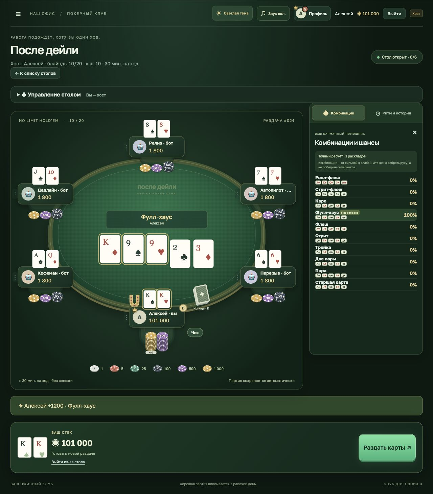
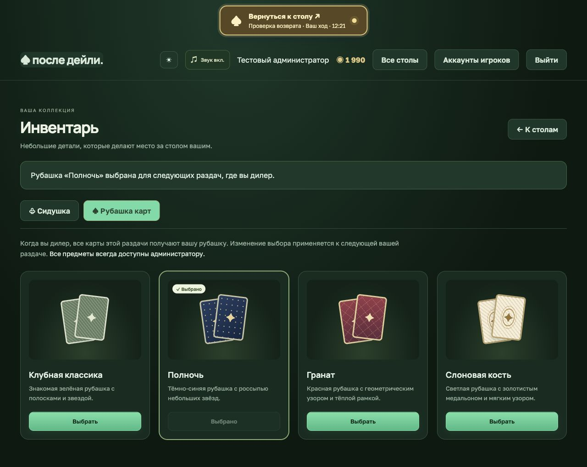

# После дейли · Office Poker

Офисный покер на **Node.js + React + TypeScript**. Аккаунты с постоянными балансами, создаваемые игроками столы Texas Hold’em No Limit, 2–6 участников за столом (люди и боты). Только игровые фишки, без денежных ставок.


## Запуск

Нужен **Node.js 24+** (проверено на 26.13).

```bash
npm ci
npm run dev
```

Открыть **http://127.0.0.1:3002**. При первом запуске на компьютере сервера появится форма создания администратора: задайте имя, логин и пароль. Автоматических паролей и публичной регистрации нет. Затем в **«Аккаунты игроков»** создайте коллегам логины, пароли и стартовые балансы. Коллеги входят в собственные аккаунты; очистка cookie больше не лишает их баланса.

Если осталась база предыдущей версии, участники и их фишки импортируются автоматически. Для сохранения доступа к прежнему хосту создайте администратора в том же браузере. Остальным импортированным игрокам администратор задаёт логины и пароли через список аккаунтов. Старая анонимная cookie сама по себе доступ к аккаунту не даёт.

Для подключения из общей офисной сети:

```bash
HOST=0.0.0.0 npm run dev
```

Коллеги открывают `http://<локальный-IP-компьютера>:3002`. Компьютеры должны находиться в доступной друг другу сети; сервер должен оставаться включённым. По умолчанию сервер доступен только локально.

Для готовой сборки:

```bash
npm run build
npm start
# Офисная сеть:
HOST=0.0.0.0 npm start
```

## Как играть

1. Войдите с логином и паролем, выданными администратором.
2. В списке столов нажмите **«Создать стол»**. Задайте название, малый и большой блайнды, максимум минут на ход (1–1440) и шаг рейза. Создатель автоматически занимает место и становится хостом. Заранее созданных комнат нет.
3. Другие игроки открывают стол и нажимают «Сесть за стол» на выбранном свободном кресле. После выхода можно выбрать другое место тем же способом. В игре используется весь баланс аккаунта; одновременно сидеть можно только за одним столом, в том числе из разных браузеров. Повторный вход не выдаёт фишки заново.
4. В самой комнате хост раскрывает **«Управление столом»**: добавляет и убирает ботов, запускает раздачу, ставит паузу и меняет правила между раздачами. Администратор также может управлять столом. При явном выходе хоста со стола права получает другой сидящий игрок. Переход в меню и временное отключение не передают права хоста.
5. В нижней панели доступны фолд, чек, колл, рейз и олл-ин. Рейз задаётся как **общая ставка текущего круга**, а не добавляемое количество. Ползунок и быстрые варианты учитывают шаг стола и минимальный легальный рейз. Олл-ин разрешён любым остатком, включая сумму, не кратную шагу. Шаг проверяется и сервером, включая ходы ботов.
6. После тайм-аута сервер делает чек, если доплачивать не нужно, иначе фолд. При олл-ине поддерживаются основной и побочные банки и ничьи.
7. Возле игрока остаётся последнее действие: **«Фолд», «Чек», «Колл N», «Рейз N»**, до его следующего действия или новой раздачи. Сброшенные карты лежат закрытыми рядом с игроком до следующей раздачи. Они не раскрываются другим игрокам, хосту или администратору. При победе без вскрытия карты победителя также остаются закрытыми для соперников.
8. Следующую раздачу запускает хост вручную. Присоединившийся во время раздачи ждёт следующую. Выйти со стола можно между раздачами; остаток баланса сохраняется в аккаунте.

### Пустующие столы

Если нет подключённых людей, занимающих места, начинается пятиминутный отсчёт. Стол **только с ботами тоже пустует**: их присутствие и ходы не сбрасывают таймер. Закрытая вкладка определяется через 45 секунд без обновлений; возвращение человека за стол отменяет удаление. Просмотр стола без занятого места таймер не сбрасывает.

При отсутствии людей сервер не продолжает разыгрывать их фишки против ботов. После пяти минут стол удаляется. Если раздача была незавершённой, людям возвращаются их собственные ставки этой раздачи; уже завершённые выигрыши и проигрыши сохраняются. База аккаунтов не удаляется.

## Игра против ботов

Хост может посадить бота на любое свободное место кнопкой **«+ Бот»** прямо на столе или в блоке **«Управление столом»** в комнате. Сначала займите место сами, добавьте одного или нескольких ботов и нажмите **«Раздать карты»**. Стол без сидящих людей считается пустующим и удаляется через пять минут.

- Бот получает отдельный стартовый стек стола и отмечен значком 🤖 и подписью «бот».
- На решение уходит примерно **3 секунды**, затем сервер автоматически делает ход; пока за столом есть подключённый человек. У людей остаётся обычный длинный таймер.
- Бот оценивает силу своих карт против случайных возможных рук соперников, учитывает общий банк и цену колла; умеет чекать, коллировать, повышать и сбрасывать.
- Чужие закрытые карты и настоящая колода не передаются стратегии бота. Это простой соперник для тренировок, без уровней сложности.
- Пауза останавливает и ботов. После перезапуска сохраняются их места, фишки и карты; автоматические ходы продолжаются.
- Добавление и удаление — между раздачами. Удалить можно кнопкой с именем бота и крестиком в управлении столом. Если бот проиграл весь стек, перед следующей раздачей он автоматически получает новый стартовый стек (по умолчанию 2000). Ненулевой остаток не пополняется, люди автоматически фишки не получают. Пополнение видно в истории.
- Новую раздачу по-прежнему запускает хост вручную.

## Раздача карт

Дилер и блайнды переходят к следующим участникам после каждой раздачи. Колода находится возле текущего дилера. Он раздаёт слева от себя по часовой стрелке сразу по две карты каждому игроку. Обе карты летят вместе, с одним звуком передачи пары. Карты появляются у игроков по мере прибытия. Флоп, тёрн и ривер также летят из колоды закрытыми, затем переворачиваются на столе.

Сервер сохраняет порядок и тайминг анимации вместе с партией. Время решения начинается после завершения раздачи; раньше этого ходить нельзя ни человеку, ни боту. Пауза замораживает движение карт, после обновления страницы анимация продолжается с текущего места. При олл-ине борд сначала открывается, затем проигрывается выплата банка.

## Итог раздачи

После вскрытия выигрышные карты борда сдвигаются чуть выше по сукну. Над ними появляется название комбинации и имя победителя. Рамкой выделяются карты самой комбинации: например, четыре карты двух пар. Кикеры учитываются при определении победителя, но не подсвечиваются. Итог остаётся на столе до следующей раздачи.

На аватаре победителя появляется маленькая золотая корона: она означает победу в последней завершённой раздаче и сохраняется во время следующей, пока не определится новый победитель. При разделе банка или разных победителях основного и побочных банков короны получают соответствующие победители. Возврат неуравненной ставки не выдаёт корону. Корона и итог сохраняются после перезапуска игры.

При победе после паса остальных игроков на столе написано «Победа без вскрытия»; комбинация не придумывается. При олл-ине новый итог и короны показываются после открытия борда.



## Звуки

В игре используются записи карт и настоящих фишек из [Kenney Casino Audio](https://kenney.nl/assets/casino-audio) (CC0): отдельные варианты для ставок и сбора выигрыша. Файлы поставляются вместе с игрой, внешние аудиосервисы не нужны. Чек сопровождается двойным сухим стуком по столу; он срабатывает у людей и ботов, включая автоматический чек. Повторное получение того же состояния не повторяет стук. Сигнал вашего хода — короткий двухнотный звук. Источник и лицензия: `public/audio/CREDITS.md`.

Если вы сидите за столом, его звуки продолжаются в списке столов, админке и других меню. Состояние и присутствие обновляются каждые 400 мс независимо от открытого меню. Сверху поверх интерфейса доступна кнопка **«Вернуться к столу»**: на вашем ходу она выделяется и показывает оставшееся время. Возврат не повторяет уже проигранные звуки. После выхода со стола или из аккаунта фоновое наблюдение прекращается.

Кнопка **«Звук вкл.» / «Без звука»** находится справа вверху и доступна также в меню. Настройка сохраняется в этом браузере. По правилам браузеров звук начинает работать после первого клика или нажатия клавиши на странице. Повторные опросы сервера не воспроизводят звук заново.

## Оформление

В шапке есть переключатель **«Клубная тема» / «Светлая тема»**. Светлая тема сохраняет исходное оформление. Клубная меняет фон, панели, сукно и кнопки на тёмные зелёные оттенки с тёплыми акцентами. Выбор сохраняется в браузере; рубашки карт и номиналы фишек одинаковы в обеих темах. Панель комбинаций немного расширена для удобства чтения.


## Инвентарь и оформление предметов

Раздел **«Инвентарь»** доступен всем игрокам из меню стола и верхней панели. Две категории, в каждой четыре варианта:

- сидушка: «Классика», «Бордо», «Океан», «Бархат»;
- рубашка карт: «Клубная классика», «Полночь», «Гранат», «Слоновая кость».

Редкость — отдельное обязательное свойство каталога (`CosmeticRarity`), независимо от категории предмета. Общие названия и цвета заданы в `cosmeticRarities`:

| Редкость                   | Рамка       | Сидушка  | Рубашка          |
| -------------------------- | ----------- | -------- | ---------------- |
| Обычная (`common`)         | Нейтральная | Классика | Клубная классика |
| Редкая (`rare`)            | Синяя       | Бордо    | Полночь          |
| Эпическая (`epic`)         | Розовая     | Океан    | Гранат           |
| Эксклюзивная (`exclusive`) | Красная     | Бархат   | Слоновая кость   |

В инвентаре редкость отмечена подписью и тонкой рамкой карточки, в том числе для закрытых и выбранных предметов. Цвет самих предметов не меняется. Будущие награды и кейсы смогут использовать эти же идентификаторы; вероятности выпадения пока не задаются.

У обычного игрока базовые предметы всегда есть в наличии и выбраны по умолчанию. Остальные видны серыми с замком, выбрать их нельзя; сервер также проверяет владение. У администратора **всегда есть весь каталог**, включая будущие добавленные предметы.

Выбор сохраняется в аккаунте и переживает выход и перезапуск. Сидушка сразу меняется на занятом игроком месте и следует за ним при смене кресла; свободное место всегда стандартное. Рубашка текущего дилера фиксируется в начале раздачи: её получают закрытые карты всех участников, колода, летящие карты и закрытый борд. Смена предмета посреди раздачи меняет только следующие раздачи этого дилера. Боты по умолчанию используют базовый набор.

Каталог находится в `shared/cosmetics.ts`, владение дополнительными предметами — в `user_items`, выбор — в `user_equipment` в SQLite. Базовые предметы и полный доступ администратора определяются сервером. Это основа для будущих наград и кейсов; сами кейсы и магазин пока не добавлены. Все узоры выполнены в CSS без внешних изображений.



## Фишки и управление столом

У каждого игрока отображается стек цветных фишек, у общего банка — отдельные стопки. Номиналы: **1, 5, 25, 100, 500, 1000**. Цветовая легенда находится под столом. Стопки раскладываются по настоящей сумме, включая нечётные остатки; длинные стопки сжимаются визуально и показывают количество в подсказке.

Сервер фиксирует каждую ставку и выплату, а интерфейс анимирует перелёт от игрока в банк и обратно. Повторное получение того же состояния не запускает анимацию заново. Настройка системы «Уменьшение движения» отключает перелёты.

В нижней панели — крупные «Пас», «Чек / Колл» и «Рейз», ползунок, точное поле суммы и быстрые варианты **«Мин.», «½ банка», «Банк», «Олл-ин»**. Сумма рейза означает общую ставку текущего круга. Быстрые варианты учитывают необходимый колл и ограничиваются легальным минимумом и вашим стеком.

Кнопка **☰** скрывает боковое меню и увеличивает доступное место и масштаб стола. На узких экранах меню открывается поверх игры. Выбор сохраняется в браузере.

## Комбинации и вероятности

Справа от стола — две компактные кнопки: **♠ Комбинации** и **◷ Ритм и история**. Комбинации и вероятности видны рядом с игрой, без модального окна. Вторая вкладка показывает таймер и историю. Повторное нажатие выбранной кнопки сворачивает панель. На узком экране панель открывается сбоку поверх части стола; нижние кнопки игры остаются доступны.

Таблица содержит комбинации от роял-флеша до старшей карты, примеры и проценты для ваших двух карт и открытого борда.

- Показана вероятность **лучшей итоговой комбинации к риверу**; категории взаимоисключающие, их сумма — 100% до округления. Это не вероятность победы против соперников.
- До флопа — стабильная приближённая оценка по 16 000 случайным продолжениям.
- На флопе — точный перебор всех **1081** продолжений, на тёрне — всех **46**, на ривере — готовый результат.
- Расчёт происходит отдельно от интерфейса и не останавливает кнопки или анимации. Закрытые карты соперников и настоящая колода не используются.
- Без карт игрока таблица служит справочником, проценты появляются после раздачи. Уже собранная комбинация выделена.

## Аккаунты и управление

**Администратор клуба** создаёт игроков, задаёт имя, уникальный логин и пароль и управляет их балансами в разделе «Аккаунты игроков». Новый пароль отзывает прежние сессии. Изменять аккаунт сидящего игрока можно между раздачами. Обычный игрок не может создавать аккаунты или сам пополнять баланс.

**Хост стола** — любой игрок, создавший стол. Его управление находится непосредственно в комнате, отдельно от аккаунтов: боты, новая раздача, пауза, блайнды, шаг и время на ход. Хост может удалять только ботов; он не может менять баланс или пароль другого игрока.

Пароли сохраняются как scrypt-хеши с индивидуальной солью, токены сессий — в виде SHA-256-хешей. Cookie HttpOnly, SameSite=Strict, срок 30 дней; при HTTPS — Secure. Есть ограничение попыток входа и проверка Origin. API не передаёт пароли, колоду или закрытые карты соперников. Баланс и состояние стола обновляются в одной SQLite-транзакции.

## Сохранение

SQLite в `data/poker.sqlite` сохраняет аккаунты, балансы, столы, колоды, таймеры, историю и сессии после каждого действия. Всё восстанавливается после перезапуска. Анимации и боты остаются серверно согласованными. Обновления игры приходят каждые 400 мс, списка столов — каждые 3 секунды. Полёт карт выполняется браузером через transform без покадровых перерисовок React.

Версия рассчитана на локальную офисную сеть. Для внешнего размещения нужен HTTPS. Восстановление пароля выполняет администратор; рассылки, публичная регистрация, кейсы, магазин и эмодзи пока не реализованы.

Переменные: `HOST` (по умолчанию `127.0.0.1`), `PORT` (`3002`), `POKER_DB_PATH` (`data/poker.sqlite`). Для отдельной тестовой партии: `PORT=3003 POKER_DB_PATH=data/test.sqlite npm run dev`.

## Структура

- `server/poker.ts` — колода и оценка комбинаций.
- `server/engine.ts` — раздачи, торги, банки и таймер.
- `server/bots.ts` — посадка ботов, оценка рук и автоматические ходы.
- `server/app.ts` — API аккаунтов и столов, права, балансы, миграция и удаление пустующих комнат.
- `server/accounts.ts` — пароли и проверка данных аккаунта.
- `shared/types.ts` — общий контракт сервера и клиента.
- `shared/poker.ts`, `shared/odds.ts` — комбинации и вероятности.
- `shared/chips.ts` — номиналы и точное разложение стека.
- `src/` — React-интерфейс стола и админ-панели.
- `tests/` — правила, случайные раздачи, API и восстановление базы.

```bash
npm test
npm run build
```

Дальше: [план развития](docs/ROADMAP.md).
