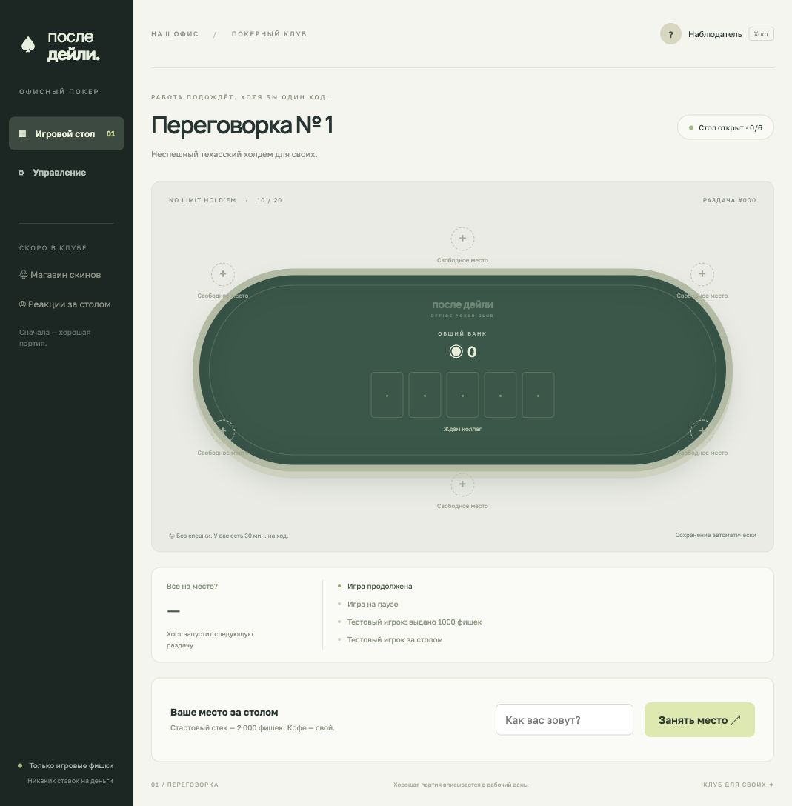
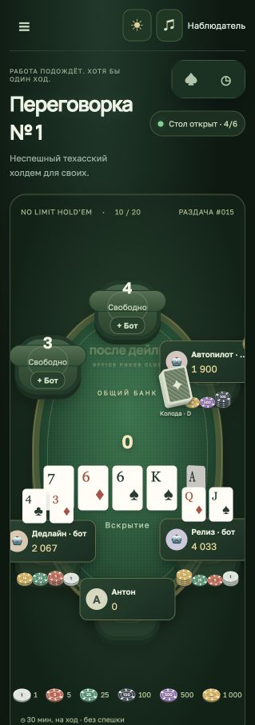

# После дейли · Office Poker

Первая версия офисного покера на **Node.js + React + TypeScript**. Один общий стол Texas Hold’em No Limit, 2–6 участников (люди и боты), игровые фишки без денежных ставок. Отдельный репозиторий; предыдущая игра не затронута.



## Запуск

Нужен **Node.js 24+** (проверено на 26.13).

```bash
npm ci
npm run dev
```

Открыть **http://127.0.0.1:3002**. Первый браузер, открывший игру с этого компьютера, становится хостом. Сначала откройте стол сами, затем приглашайте коллег. Права и личность привязаны к cookie браузера. Другая вкладка этого же браузера — тот же игрок; для второго участника нужен другой браузер, приватное окно или устройство.

Для подключения из общей офисной сети:

```bash
HOST=0.0.0.0 npm run dev
```

Коллеги открывают `http://<локальный-IP-компьютера>:3002`. Компьютеры должны находиться в доступной друг другу сети; сервер должен оставаться включённым. По умолчанию сервер доступен только локально.

Для готовой сборки:

```bash
npm run build
npm start
# Офисная сеть:
HOST=0.0.0.0 npm start
```

## Как играть

1. Введите имя и займите место. Начальный стек — **2 000** фишек.
2. При двух участниках хост нажимает «Раздать карты». Блайнды **10/20**.
3. На каждый ход даётся **30 минут**, включая каждый круг торговли. Доступны пас, чек, колл, рейз и олл-ин. Рейз задаётся как **общая ставка текущего круга**, а не добавляемое количество.
4. После тайм-аута сервер делает чек, если доплачивать не нужно, иначе пас. Отключение браузера не останавливает таймер.
5. Сервер открывает флоп, тёрн и ривер, определяет комбинации и делит основной и побочные банки. Олл-ины и ничьи поддерживаются; нечётная фишка выдаётся первому победителю слева от дилера.
6. Следующую раздачу запускает хост вручную. Коллега, присоединившийся во время раздачи, ждёт следующую. Выйти со стола можно между раздачами; остаток фишек при выходе не сохраняется как отдельный кошелёк.

## Игра против ботов

Хост может посадить бота на любое свободное место кнопкой **«+ Бот»** прямо на столе или в разделе **«Боты за столом»** админ-панели. Сначала займите место сами, добавьте одного или нескольких ботов и нажмите **«Раздать карты»**. Можно также запустить стол только с ботами и наблюдать.

- Бот получает тот же стартовый стек и отмечен значком 🤖 и подписью «бот».
- На решение уходит примерно **3 секунды**, затем сервер автоматически делает ход; открытый браузер для этого не нужен. У людей остаётся обычный длинный таймер.
- Бот оценивает силу своих карт против случайных возможных рук соперников, учитывает общий банк и цену колла; умеет чекать, коллировать, повышать и сбрасывать.
- Чужие закрытые карты и настоящая колода не передаются стратегии бота. Это простой соперник для тренировок, без уровней сложности.
- Пауза останавливает и ботов. После перезапуска сохраняются их места, фишки и карты; автоматические ходы продолжаются.
- Добавление, удаление и пополнение фишек — между раздачами. Удалить можно кнопкой **«Убрать бота»** в списке участников. Если бот проиграл весь стек, перед следующей раздачей он автоматически получает новый стартовый стек (по умолчанию 2000). Ненулевой остаток не пополняется, люди автоматически фишки не получают. Пополнение видно в истории.
- Новую раздачу по-прежнему запускает хост вручную.

## Раздача карт

Дилер и блайнды переходят к следующим участникам после каждой раздачи. Колода находится возле текущего дилера. Он раздаёт слева от себя по часовой стрелке два круга по одной карте, с шелестом на каждом перелёте. Карты появляются у игроков по мере прибытия. Флоп, тёрн и ривер также летят из колоды закрытыми, затем переворачиваются на столе.

Сервер сохраняет порядок и тайминг анимации вместе с партией. Время решения начинается после завершения раздачи; раньше этого ходить нельзя ни человеку, ни боту. Пауза замораживает движение карт, после обновления страницы анимация продолжается с текущего места. При олл-ине борд сначала открывается, затем проигрывается выплата банка.

## Звуки

В игре используются записи карт и настоящих фишек из [Kenney Casino Audio](https://kenney.nl/assets/casino-audio) (CC0): отдельные варианты для ставок и сбора выигрыша. Файлы поставляются вместе с игрой, внешние аудиосервисы не нужны. Чек сопровождается двойным сухим стуком по столу; он срабатывает у людей и ботов, включая автоматический чек. Повторное получение того же состояния не повторяет стук. Сигнал вашего хода — короткий двухнотный звук. Источник и лицензия: `public/audio/CREDITS.md`.

Кнопка **«Звук вкл.» / «Без звука»** находится справа вверху. Настройка сохраняется в этом браузере. По правилам браузеров звук начинает работать после первого клика или нажатия клавиши на странице. Повторные опросы сервера не воспроизводят звук заново.

## Оформление

В шапке есть переключатель **«Клубная тема» / «Светлая тема»**. Светлая тема сохраняет исходное оформление. Клубная меняет фон, панели, сукно и кнопки на тёмные зелёные оттенки с тёплыми акцентами. Выбор сохраняется в браузере; рубашки карт и номиналы фишек одинаковы в обеих темах. Панель комбинаций немного расширена для удобства чтения.



## Фишки и управление столом

У каждого игрока отображается стек цветных фишек, у общего банка — отдельные стопки. Номиналы: **1, 5, 25, 100, 500, 1000**. Цветовая легенда находится под столом. Стопки раскладываются по настоящей сумме, включая нечётные остатки; длинные стопки сжимаются визуально и показывают количество в подсказке.

Сервер фиксирует каждую ставку и выплату, а интерфейс анимирует перелёт от игрока в банк и обратно. Повторное получение того же состояния не запускает анимацию заново. Настройка системы «Уменьшение движения» отключает перелёты.

В нижней панели — крупные «Пас», «Чек / Колл» и «Рейз», ползунок, точное поле суммы и быстрые варианты **«Мин.», «½ банка», «Банк», «Олл-ин»**. Сумма рейза означает общую ставку текущего круга. Быстрые варианты учитывают необходимый колл и ограничиваются легальным минимумом и вашим стеком.

Кнопка **☰** скрывает боковое меню и увеличивает доступное место и масштаб стола. На узких экранах меню открывается поверх игры. Выбор сохраняется в браузере.

## Комбинации и вероятности

Справа от стола — две компактные кнопки: **♠ Комбинации** и **◷ Ритм и история**. Комбинации и вероятности видны рядом с игрой, без модального окна. Вторая вкладка показывает таймер и историю. Повторное нажатие выбранной кнопки сворачивает панель. На узком экране панель открывается сбоку поверх части стола; нижние кнопки игры остаются доступны.

Таблица содержит комбинации от роял-флеша до старшей карты, примеры и проценты для ваших двух карт и открытого борда.

- Показана вероятность **лучшей итоговой комбинации к риверу**; категории взаимоисключающие, их сумма — 100% до округления. Это не вероятность победы против соперников.
- До флопа — стабильная приближённая оценка по 16 000 случайным продолжениям.
- На флопе — точный перебор всех **1081** продолжений, на тёрне — всех **46**, на ривере — готовый результат.
- Расчёт происходит отдельно от интерфейса и не останавливает кнопки или анимации. Закрытые карты соперников и настоящая колода не используются.
- Без карт игрока таблица служит справочником, проценты появляются после раздачи. Уже собранная комбинация выделена.

## Управление

Хосту доступна вкладка «Управление»:

- пауза и продолжение с сохранением оставшегося времени;
- блайнды, стартовый стек для новых участников и время на ход (1–1440 минут);
- выдача игровых фишек и удаление участника между раздачами;
- запуск новой раздачи.

Изменения правил и стеков запрещены во время раздачи. Карты соперников скрыты на сервере, включая для хоста. На вскрытии открываются только карты не сбросивших участников.

## Сохранение и ограничения MVP

SQLite в `data/poker.sqlite` сохраняет стол, колоду, скрытые карты, таймер, историю и сессии после каждого действия. После перезапуска истёкший ход обрабатывается сервером; новая очередь получает полное окно. Пауза сохраняется. Обновления приходят каждые 400 мс; анимация идёт по общему серверному времени.

Это версия для доверенной локальной офисной сети. Нет паролей, восстановления аккаунта, отдельных кошельков, нескольких столов, расписания рабочих часов и публичного хостинга. При очистке cookie теряется доступ к прежнему игроку и роли хоста. Не публикуйте этот MVP в открытый интернет без полноценной авторизации и HTTPS. Скины, эмодзи и магазин пока только обозначены в интерфейсе как будущие возможности.

Переменные: `HOST` (по умолчанию `127.0.0.1`), `PORT` (`3002`), `POKER_DB_PATH` (`data/poker.sqlite`). Для отдельной тестовой партии: `PORT=3003 POKER_DB_PATH=data/test.sqlite npm run dev`.

## Структура

- `server/poker.ts` — колода и оценка комбинаций.
- `server/engine.ts` — раздачи, торги, банки и таймер.
- `server/bots.ts` — посадка ботов, оценка рук и автоматические ходы.
- `server/app.ts` — API, сессии, права, сохранение.
- `shared/types.ts` — общий контракт сервера и клиента.
- `shared/poker.ts`, `shared/odds.ts` — комбинации и вероятности.
- `shared/chips.ts` — номиналы и точное разложение стека.
- `src/` — React-интерфейс стола и админ-панели.
- `tests/` — правила, случайные раздачи, API и восстановление базы.

```bash
npm test
npm run build
```

Дальше: [план развития](docs/ROADMAP.md).
